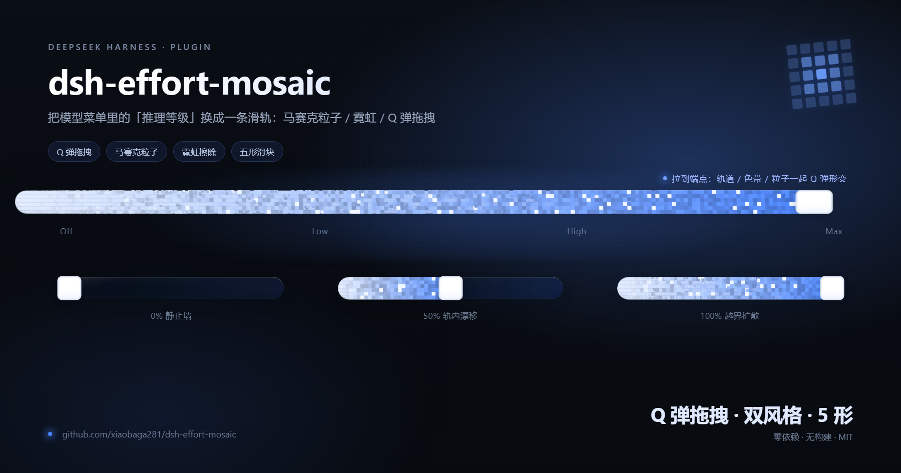
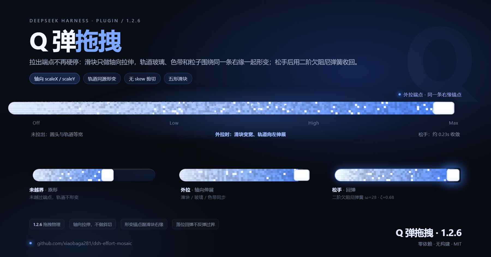
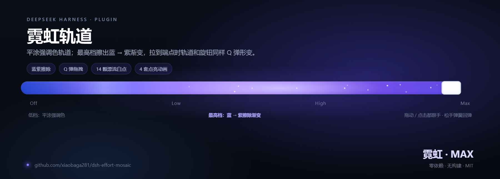
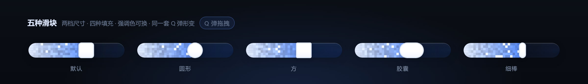

# dsh-effort-mosaic

<p align="center">
  <a href="https://github.com/xiaobaga281/dsh-effort-mosaic/releases/latest"></a>
  <a href="https://github.com/xiaobaga281/dsh-effort-mosaic/blob/main/LICENSE"></a>
  
  
</p>

<p align="center">接管 DSH 模型菜单里的「推理等级」那一行，换成一条滑轨。两套风格任选：<b>马赛克粒子墙</b> 或 <b>霓虹</b>。</p>

**马赛克**（默认）—— 右侧贴着滑块的那一段是严丝合缝的静止墙；越往左，方块越早脱离网格，向左漂、上下散、逐渐淡出；档位越高跑得越快，到最高档点亮一次。

**霓虹** —— 平涂强调色的胶囊轨道；切到最高档时，一块同色蓝盖板向左退场，把蓝→紫的整条渐变「擦」出来，同时滑块脚下炸一圈火星、14 颗白点由右向左漂过。白点直径 3px，火星 2.8–5.2px，比初版大一圈，远看不再像灰尘。

- **看得见强度** —— 一条连续轨道比 Off / Low / High / Max 四个字直观
- **苹果式液态玻璃 + 端点弹性** —— 透明玻璃壁、边缘镜面和背景 blur；横向中段静止，纵向上下拖可拉高/压扁，越过端点才做横向回弹
- **手感连续** —— 拖动跟手不跳档；松手按临界阻尼收口；点击只判最近档位，不先跳到指针
- **最高档有代价感** —— 马赛克默认只有开满时粒子才飞出轨道，四套越界动画；霓虹是擦除 + 烟花
- **可调到底** —— 5 种滑块 × 2 档尺寸 × 4 种填充，颜色与幅度都能改

档位表不写死：跟随当前模型在 `reasoning.efforts` 里声明的档位；模型没声明就不接管这一行（fail-open）。最高档时，输入框胶囊里的档位名会染成品牌蓝。

## 预览









## 安装

```sh
dsh plugin --profile web add dsh-effort-mosaic
```

桌面端：设置 → 插件 → 添加插件，填 `dsh-effort-mosaic`，或仓库地址 `https://github.com/xiaobaga281/dsh-effort-mosaic`。

也可以从 GitHub 装（无构建步骤，内容与 npm 一致）：

```sh
dsh plugin --profile web add "github:xiaobaga281/dsh-effort-mosaic"
```

> 包名与仓库名现在统一为 `dsh-effort-mosaic`。改名过渡期曾短暂用过 `dsh-effortmosaic`，那个包不再维护，**别填错**。

**卸载**：`dsh plugin --profile web remove dsh-effort-mosaic`；桌面端在插件页里卸载。

**要求**：DSH Desktop `0.2.1-rc.3` 及以上，Node `>= 22`（仅测试用）。零运行时依赖、无构建步骤；改过 `lib/client.js` 需**整进程重启**才生效。

## 交互

| 操作 | 行为 |
|---|---|
| 按住拖动 | 两档之间完全自由跟手（平面距离超过 5px 才算拖动，之前滑块一像素不动）；横向中段轨道不形变，纵向上下拖可拉高/压扁 |
| 拖过端点 | 滑块到 0 / 最高档后继续外拉，轨道玻璃、色带、粒子与滑块一起弹性拉伸；锚点贴在滑块这一侧，轨道不会越过滑块外沿 |
| 纵向拖动 | 以按下点为基准上下拉，纵向位移超过 8px 且明显大于横向位移时生效，中段也响应；形变和粒子统一裁在宿主浮层内 |
| 松手 | 吸附到最近档位，约 0.25s；松手位置正好在档位上时不动，不再向右补一段 |
| 点击轨道 | 判定离指针最近的档位；pointerup 同帧把目标像素写到旋钮和填充，滑块立即起 `.3s` CSS 过渡，不等待 React 提交 |
| `←` `→` `↑` `↓` / `Home` `End` | 相邻档位 / 首尾档，同样走 `.3s` CSS 过渡 |
| 档位落库 | 视觉落位同一帧先改官方字符 + 乐观 draft；宿主写入再让出两帧，排队到渲染空闲才执行；连续换档只保留最后目标，关浮窗前未落库会补写 |

拖动只改本地显示位置，松手进入临界阻尼吸附；**点击 / 键盘换档走 `.3s` CSS 过渡**（离散操作，平滑到位即可）。两条路径的落位帧都汇入同一套「无感引擎」：先把官方行 / 输入胶囊里的档位字符、最高档染色和 draft 一起切到目标，再让出两帧、等渲染线程空闲才进宿主同步桥。于是滑块到位、字符切换、宿主落库三层解耦 —— 用户看到的是同步切换，同步桥的 0.1–0.3s 停顿则被挪到动画结束之后。写入失败时 draft 清空，字符与染色随 effect 回滚到真实档位。两种轨道共用这两条路径 —— 以后调手感只改一处，粒子轨和霓虹轨一起变。切到最高档时，点亮动画等滑块滑到位再播。

## 视觉

一条 30px 高的胶囊凹槽，自下而上叠四层：填充渐变 → 6 行 × 5px 粒子 → 刻度 → 滑块。填充、粒子、凹槽共用同一条轮廓：右端按滑块内缘收口，带高跟随滑块（`min(30, 滑块高)`），接缝处不会露出蓝边。拖动形变时色带和滑块共用同一条右端收口线；滑块只做轴向缩放，圆头半径会按形变后的短边反算回本地坐标，拉伸后圆头仍是圆头，不会变成斜片或椭圆；轨道只保留很轻的 `skewX` 做方向感。`scale / skew` 也不会让色轨从旋钮右上、右下探出来。

粒子按离滑块的距离决定散开程度：右侧 2% 是严格贴网格的墙，往左 `amp` 增大、漂移与抖动随之变大，最左端几乎全部脱离。颜色取自同一条渐变色阶 × 明度系数（0.80–1.06），砖缝从浅蓝到纯蓝都看得清。

**四种点亮动画**（最高档触发，两套风格都有）：能量波 / 扫描线 / 爆散 / 呼吸。马赛克那组的最高档速度由稳定的顶部提速托住，入口只额外叠一次很轻的抬速，不会在 0.3 秒后掉回基础速度；霓虹沿用同一套语义，但峰值更低（紫渐变的亮度天花板比浅蓝低，1.55 倍会烧成白块），且不做饱和变化。

**四套越界动画**（仅马赛克，默认仅最高档）：飞沫 / 飘散 / 坠落 / 潮汐 —— 右 1/5 是死区，越往左逃逸比例越高、飞得越远。

切到 **霓虹** 后轨道是平涂强调色；最高档填充是逐点采样自原版的蓝→紫渐变（`#2546D0 → #B37DFF → #724CE9`），由一块同色蓝盖板向左移「擦」出来 —— 盖板右缘 96px 渐变到全透明，所以边界是软的，没有接缝。

## 自定义版式

插件详情页里有一块面板，预览直接使用正式的三档轨道（Off / Medium / Max），可以拖动、点击、键盘切换；改任何一项即时生效，最高档字符按当前染色设置显示，旁边可「播放」重播一次点亮。打开「拖拽动效」开关时会自动演示一次端点 / 纵向形变，不用真的去拖也能看出差别。越界选「全档位」会把预览自动停到 Medium、选「最高档」停回 Max，两种模式当场就能对上画面。点击预览轨道时，档位字符等滑块 `.3s` 过渡收口后再切换，不会在滑块还在走的时候提前跳字。预览的粒子遮罩变量完全由每帧的 `syncTail` 按真实滑块位置写，点击瞬间不会再先跳到目标档位；粒子边缘也按滑块内缘连续裁切，不按 5px 整格淘汰，从 Max 切到 Medium 时右缘不会闪一下或一格一格地空/满跳。详情页面板本身锁定为固定浅色，不跟随宿主深浅主题；选中项白底蓝字，预览卡浅蓝底，宿主没注入 `--dsw-alias-*` 也不会变成黑底黑字。面板内的强调色 swatches、hex 输入、分段控件、滑杆、预览标签和底部按钮都带换行 / 最大宽度约束，详情页窗口收窄到 160px 也不会横向溢出；纵向高度交给宿主详情页自己的滚动容器，不在面板里再套一层滚动。

| 项 | 取值 | 默认 |
|---|---|---|
| 轨道风格 | 马赛克 / 霓虹 | 马赛克 |
| 拖拽动效 | 开 / 关 | 开（端点外拉 + 中段纵向弹性形变） |
| 玻璃材质 | 开 / 关 | 开（液态玻璃：背景折射 + 上缘镜面 + 底缘厚度） |
| 滑轨强调色 | 6 个预设 + 任意 hex | `#4A84FF` |
| 最高档字符 | 跟随强调色 / 自定义 | 跟随强调色 |
| 滑块形状 | 默认（圆角方形） / 圆形 / 方 / 胶囊 / 细棒 | 默认 |
| 滑块大小 | 30 / 34 px | 30 |
| 滑块填充 | 白瓷 / 染色 / 强调色 / 磨砂 | 白瓷 |
| 点亮样式 | 能量波 / 扫描线 / 爆散 / 呼吸 | 能量波 |
| 点亮强度 | 0.4 – 1.8× | 1.0× |
| 点亮速度 | 0.6 – 1.4× | 1.0× |
| 粒子越界 | 关 / 仅最高档 / 全档位 | 仅最高档 |
| 越界动画 | 飞沫 / 飘散 / 坠落 / 潮汐 | 飞沫 |
| 越界幅度 | 0.4 – 2.4× | 1.6× |

整套配色由强调色派生（填充渐变、粒子、光晕同源），不会出现"轨道变了、粒子还是旧蓝"。设置留在 `localStorage` 的 `dsh-effort-mosaic:settings:v1`，面板底部可一键恢复默认。

「拖拽动效」关掉后，滑块仍严格跟手、松手仍吸附档位，但端点外拉 / 中段上下拖不再让轨道和滑块拉伸；「玻璃材质」关掉后，轨道退成扁平底 + 1px 描边，不再有背景模糊、镜面和底部厚度。两项默认开启，旧存档升级后手感与外观不变。

### 两种轨道风格

| 风格 | 轨道 | 最高档 | 粒子越界 |
|---|---|---|---|
| **马赛克**（默认） | 像素方块墙，越往左越散 | 四套点亮动画任选 | ✅ 飞沫 / 飘散 / 坠落 / 潮汐 |
| **霓虹** | 平涂强调色胶囊 | 蓝→紫擦除渐变 + 滑块脚下烟花 + 14 颗右→左漂流白点 | ❌ 不提供 |

粒子越界是马赛克风格独有的能力：切到霓虹后，面板里的「粒子越界 / 越界动画 / 越界幅度」整组会消失。**其余设置两套通用** —— 强调色、滑块形状/大小/填充、点亮样式与强度/速度都照常生效，只是霓虹的点亮作用在紫渐变上、用更低的峰值：强度决定四套动画的亮度峰值，速度决定动画时长（定时器同步跟随，不会把慢速档拦腰截断）。马赛克的「点亮速度」只调入口那一下轻抬速的衰减，最高档的稳定速度由顶部提速托住，不会把它拖慢。

霓虹最高档的渐变**跟着强调色走**：默认强调色下逐点等于原版采样值（`#2546D0 → #B37DFF → #724CE9`），换成红/绿主题后整条渐变按同一 RGB 偏移平移，得到同结构的红紫/绿紫渐变；滑块脚下的火星与底纹也跟着强调色变。

两套风格在 CSS 层面完全隔离：所有 `.dem-codex*` 规则都挂 `[data-rail='codex']` 前缀，防止以后串味。

## 实现要点

改动前值得知道的几条约束（都是踩过坑的地方）：

1. **右端收口要分层处理**：半圆端帽不能用单层 `clip-path` 硬切（它只有轴对齐四条边，会露方角），必须用 `TAIL_MASK` + `mask-clip: no-clip`；粒子层的直线右缘可以在自身宽度上用 `clip-path` 收口，但右端 inset 必须和填充共用 `--dem-knob-tail-inset`，否则两层各收各的，动画一开就会错位。
2. **拖动吸附是临界阻尼闭式解**：松手 ω=22（带指针初速），收尾时间取 `9.5/ω`，写死上限会在末尾剩几个像素硬跳。点击 / 键盘换档不走这条曲线，直接走 `.dem-knob / .dem-fill` 的 `.3s` CSS 过渡 —— 离散操作平滑到位即可，弹簧尾巴反而会在档位前"顿一下"。
3. **点亮等落位**：`shownIndex` 是乐观档位，点下去就变；拖动由 `beginSettle` 在滑块进入目标 1% 时播，点击 / 键盘由 `landByCss` 的 330ms 兜底定时器播，否则光先铺完、滑块才到。
4. **墙区的格子首帧也要写 `transform`**（`c.placed`），否则天生就在墙区的那几列永久停在轨道 `(0,0)`，看着像"多了一颗不动的蓝方块"。
5. **写 DOM 前对 `x / y / scale / op` 做有限性兜底**：任何一个 `NaN` 都会让浏览器丢弃整条 `transform`。
6. **越界强度是阻尼值**，每帧朝目标指数逼近（进 τ=0.24s / 退 τ=0.17s）；换成"线性进度 + 缓动"会在退档末尾先呆住再急收。
7. **索引到最高档 ≠ 滑块到位**：索引在点下去那一刻就变，滑块还要靠弹簧滑 0.22s。霓虹的变色与烟花绑定的是 `landedTop = 索引到顶 && 没在吸附 && 没在拖动`，否则烟花会在旧位置炸、滑块再追上去。
8. **两种轨道共用同一条落位判定**：索引到最高档不等于滑块到位，点亮绑定 `landedTop`；进入目标 1% 才兑现。霓虹不再有"提前收工"分支 —— 手感只维护一份，粒子轨和霓虹轨一起调。
9. **松手起点用最新指针位置**：`shownPctRef` 是上一帧渲染值，直接拿它起吸附会在松手后又向右补一小段；`beginSettle` 接收 `fromOverride`，并用 `data-snapping` 把最终位置先定格、下一帧再恢复过渡。
10. **端点严格内切**：`travel = 轨道宽 − 滑块宽`，`pct=1` 时滑块右缘正好贴轨道宽；不再用 `+2 / −1` 让两端各出界 1px（最高档的蓝色薄边就是它）。
11. **霓虹填充也套收口遮罩**：填充竖切位置用 `calc(100% - var(--dem-knob-tail-inset))` 从自身宽度反推，CSS 过渡期间也跟手；滑块外缘只与轨道底色接触，不会混出蓝边。旋钮投影改成中性深色，避免蓝灰影沿圆边染出"轨道色渗出"的假象。
12. **遮罩边缘必须有 1px 斜坡**：`mask-image` 从 `#000` 直接切 `transparent` 是硬切换，落在亚像素坐标上就是锯齿。写成 `calc(x - .5px) → calc(x + .5px)`（径向 −1px），再把圆心吸附到设备像素，边缘才不抖。
13. **描边用 inset 阴影画，不用 border**：border 由边框绘制器单独栅格化，压在渐变填充上会留一道 1px 浅缝，圆边的抗锯齿也会断。
14. **收口位置跟着形状走**：默认 / 正圆 / 圆角方 / 胶囊都切在滑块圆心，填充必须铺到滑块下方；只有比带高还窄的 `blade` 把竖切贴到左缘（向滑块内让 1px），否则细棒左侧会留一条暗缝。圆角滑块压在填充上时露出的那一角，由旋钮外圈 1px 中性护栏盖住。
15. **粒子动画只能动 `transform`**：霓虹的 14 颗白点如果动画 `left`，每帧都要重排整棵子树（里面还压着带遮罩的填充），必掉帧；改成等宽空壳 + `translateX` 走合成层。这 14 颗与 18 颗火星的节点也必须在模块加载时建一次，不能每次渲染重建。白点 3px、火星 2.8–5.2px。
16. **旋钮位置用 `left`，和填充 `width` 同一条布局路径**：旋钮若单独改成 `translate`（合成层），填充宽度还在主线程重排，两条渲染路径速度不一致，换档时就会看到色轨滞后。两者都走 `left` / `width` 和同一条 `.3s` 曲线；WAAPI 的 `scale` 脉冲仍走 `transform`。
17. **霓虹的「点亮强度 / 速度」必须落到自己的 CSS 变量上**：只喂 `burstPower` 是不够的（那是马赛克粒子引擎），紫渐变的 filter 峰值和时长由 `--dem-neon-peak-* / --dem-neon-dur-*` 控制，点亮定时器也要按同一个时长收尾。
18. **点击的第一帧必须同步写 DOM，宿主写入要延后**：`landByCss` 先把目标像素直接写到旋钮 `--dem-knob-x` 和填充 `width`，等 React 提交就晚了半拍。宿主的 `access.select` 是同步桥，实测一次写入会让渲染线程停 0.1–0.3s；无感引擎把宿主写入排到「视觉落位 + 两帧 + `requestIdleCallback`」之后，字符在落位帧由 `paintEffortEverywhere` 乐观切换，MutationObserver 在等待回写期间守住文字，失败再由 draft 回滚。连续换档只保留最后一次目标；浮窗提前关闭则在卸载时补写。
19. **菜单桥是全局单例，动画墙离开视口就停**：`MutationObserver` + 一个全局 350ms 自愈定时器覆盖所有 composer，最后一个会话卸载时一起停掉，不再每个会话各开一个 interval；粒子墙用 `IntersectionObserver` 暂停不可见轨道的 rAF，回到视口再续上一帧；滑块几何每帧只读一次并缓存 4ms，重复的 `width / clip-path / transform` 写入先比对再落 DOM。

## 运行时文件

```
lib/client.js        全部实现（CJS closure bundle，无构建步骤）
lib/index.js         宿主侧：空逻辑，只让 Loader 扫到这个包
cordis.patch.yml     host 图里插入这一行（`- insert: - id: effort-mosaic`）
icon.svg             插件图标（详情页 / 列表）
package.json         包元数据
CHANGELOG.md         完整版本记录
README.md / LICENSE  说明与许可
```

`npm publish` 只带 `package.json` 的 `files` 白名单：`lib/`、`cordis.patch.yml`、`icon.svg`、`README.md`、`CHANGELOG.md`、`LICENSE`。开发测试、宣传图生成器和诊断脚本不随插件发布。

修改 `lib/client.js` 后必须重启 DSH 宿主：宿主在启动时按 bundle 计算 `rev`，只刷新页面会继续请求旧 `rev` 并返回 404，看起来像插件没有加载。

## 更新日志

完整记录见 [CHANGELOG.md](./CHANGELOG.md)。

- **1.2.6** — 修复滑块拖拽时被斜切成“左低右高”、圆头在非等比缩放下变椭圆、横向滑到端点时误触发纵向拉伸，以及松手回弹偏慢；同时清掉旧包名配置双注册、`TRACK_INSET`、旧 `codexDustNodes` 包装、`tintQueued` 死变量和宿主侧启动审计，测试接缝只保留宣传图生成器实际使用的函数；菜单桥改为全局单例，不可见轨道暂停 rAF，滑块几何与 DOM 样式写入加缓存；滑块形状整理为「默认（圆角方形）/ 圆形 / 方 / 胶囊 / 细棒」，移除空心环，新增锁定正圆轮廓的「圆形」，并修复细棒与色轨之间的暗缝。
- **1.2.5** — 修复每次打开推理等级浮层滑轨慢一帧，以及最高档光带不跟随轨道形变；恢复市场宣传图与 README 预览资产。
- **1.2.4** — 修复最高档轨道 / 滑块光晕退场太直接：光晕改为 2.2s 扩散衰减，上缘发丝光保留；修复首次打开浮窗粒子越界晚一拍，以及开启粒子扩散后重开面板延迟：建墙回到 `useLayout` 并用 `DocumentFragment` 一次插入，冷启动直接满散，裁切高度按实际散开幅度动态计算。
- **1.2.3** — 修复最高档粒子速度前快后慢：`burstPower` 不再把速度从 2.6× 衰减回 1×，最高档改用稳定的顶部提速，只在入口叠加 0.06× 轻抬；修复详情页自定义设置在窄窗口下强调色 swatches / hex、分段控件、滑杆、预览标签与底栏横向溢出，面板在 160–360px 宽度内均无横向溢出。
- **1.2.2** — 修复切换模型后推理滑轨偶尔空白：旧 `reasoningEffort` 先用新模型的档位表校验，失效时回落 `defaultEffort`；目录换代时重新解析并订阅新 store，新目录不再被旧加载节流跳过；只要模型声明了档位，轨道就有兜底落点，不再留下 30px 空占位。另修复拉到最高档后立即切模型、新模型非最高档字符被旧最高档索引误染蓝的问题。
- **1.2.1** — 修复详情页面板在未注入 DSH 令牌的宿主里选中块纯黑、文字看不清、预览黑底；色带与粒子层改用同一条右端收口，拖拽 `scale / skew` 时不会在滑块右缘露出色轨；粒子引擎的逐帧 `clip-path` 不再把右侧重新放开。
- **1.2.0** — 详情页预览接入真实三档轨道与「拖拽动效 / 玻璃材质」开关；无感档位引擎将字符切换提前到视觉落位帧；修复玻璃上缘过厚、旋钮浅色环、轨道底缘硬黑线；修复输入胶囊 Max 染色先蓝后灰再蓝；发布包只保留运行文件。
- **1.1.9** — 补充 `screenshots.json` 与 `engines.dsh`，修复插件市场介绍页无截图、宿主要求显示未知。
- **1.1.8** — 修复最高档滑块光晕熄灭太直接：进入保持快，退出改为 1.05s 呼吸式衰减；粒子和霓虹同时生效。
- **1.1.7** — 修复霓虹最高档先露整条紫色、再播擦除的问题：落位后蓝盖板先满覆盖，点火时再从 0 向左退，只擦一次。
- **1.1.6** — 修复最高档滑块右缘的橙色直角：遮罩改为填充/粒子层本地解析，右端圆角取滑块外缘；修复打开浮层时从 0 档划到真实档位。
- **1.1.5** — 文档维护：新增霓虹轨道宣传图（真实 CSS 渲染），补齐 npm `homepage` / `bugs` 元数据；无运行时变化。
- **1.1.4** — 修复白瓷旋钮边缘仍残留 1px 轨道色；粒子轨填充不再被 rAF 每帧覆写，切换轨道风格会重建粒子墙；补齐点击/拖动与色轨同步、档位吸附、精确端头点亮和霓虹粒子尺寸。
- **1.1.3** — 修复关闭浮窗后轨道消失、每次打开从最左端划到真实档位；测试接口不再进入正式 bundle。
- **1.1.2** — 菜单关闭时保留挂载，切档后再开可复用。
- **1.1.1** — 无档位 / 目录重建时交还官方行；多弹层不再误拆轨道。
- **1.1.0** — 新增霓虹轨道风格。

## 兼容性

同一个「推理等级」行只能有一个接管者。本插件会替换该行的内容，请勿与其他同类滑轨插件同时启用。

## 许可

MIT
